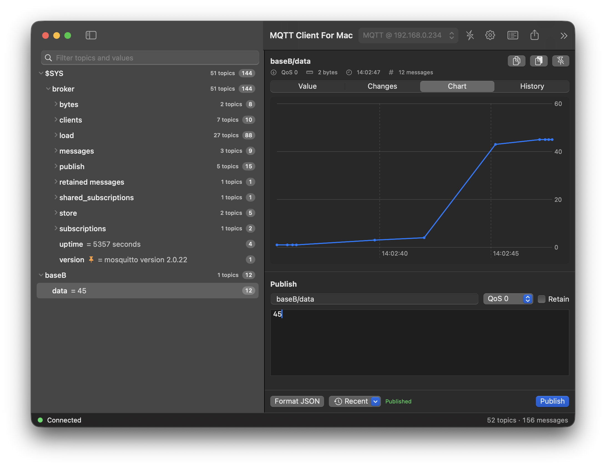

# MQTT Client For Mac

A simple, native MQTT client for Mac with Apple Silicon, written in Swift and SwiftUI.
Connect to a broker, browse all topics in a tree, watch values change, and publish messages.

New here? Read the [quick start](USAGE.md).

## Features

- Topic tree with live values, retained markers and flashing rows on new messages
- Value view as text, JSON or hex, change view, chart for numeric values, message history
- Publish with QoS 0/1/2 and retain, recent messages, JSON formatting
- Editable subscriptions, with feedback when the broker refuses one
- TLS with CA certificate and client certificate (.p12), plus a **Test connection** diagnostic
- Finds brokers on the local network (Bonjour and a scan of ports 1883 / 8883)
- Automatic reconnect, export of the topic tree as JSON
- Passwords and certificates are stored in the macOS Keychain

## Build and run

Requires macOS 14 or newer and the Swift toolchain (Xcode).

    swift run

or open the folder in Xcode and press Cmd-R.

For a regular `.app`: File > New > Project > macOS App (SwiftUI), delete the generated
`*App.swift` and `ContentView.swift`, and add `Sources/MQTTClientForMac/*.swift`.

### Local network discovery

- Copy the two keys of `Info.plist` (`NSLocalNetworkUsageDescription`, `NSBonjourServices`) into the target's Info tab.
- With App Sandbox enabled, turn on *Outgoing Connections (Client)*.
- The first time, macOS asks for *Local Network* access. Allow it.

The network scan sends an anonymous MQTT CONNECT to ports 1883 and 8883 on your local /24 network.
Use it only on networks you are allowed to scan.

## Privacy

The app only talks to the broker you configure. There is no telemetry or analytics.
Connection profiles (host, port, user name, subscriptions) are stored in the app preferences on your Mac.
Passwords, the client certificate and its password are stored in the macOS Keychain.
Recently published messages are stored in the app preferences as well.

## Status

Early version. MQTT 3.1.1 over TCP and TLS. MQTT 5 and WebSocket are not supported yet.
